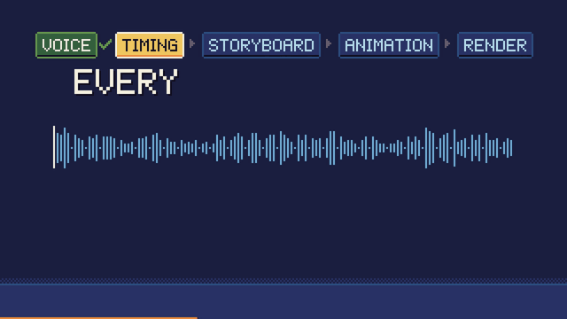
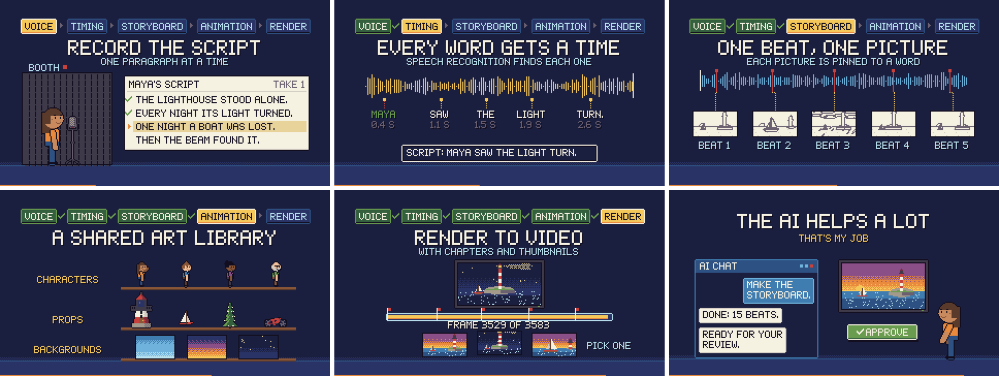
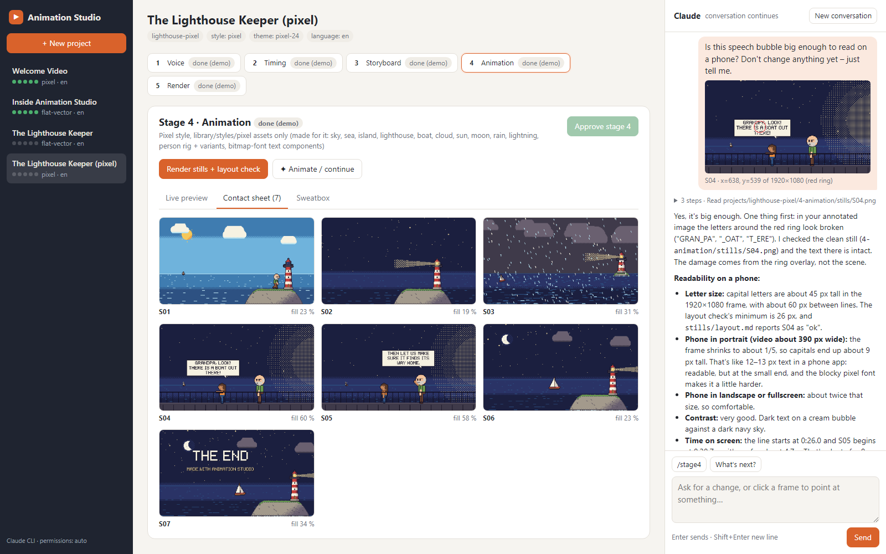
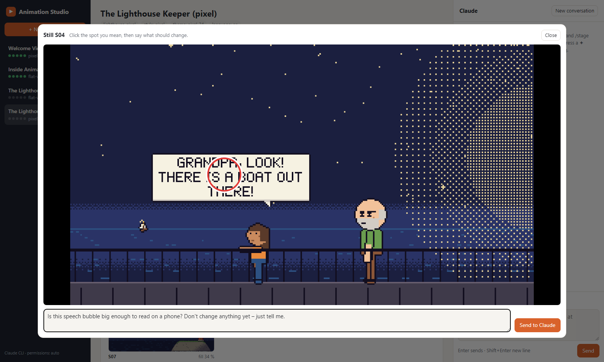
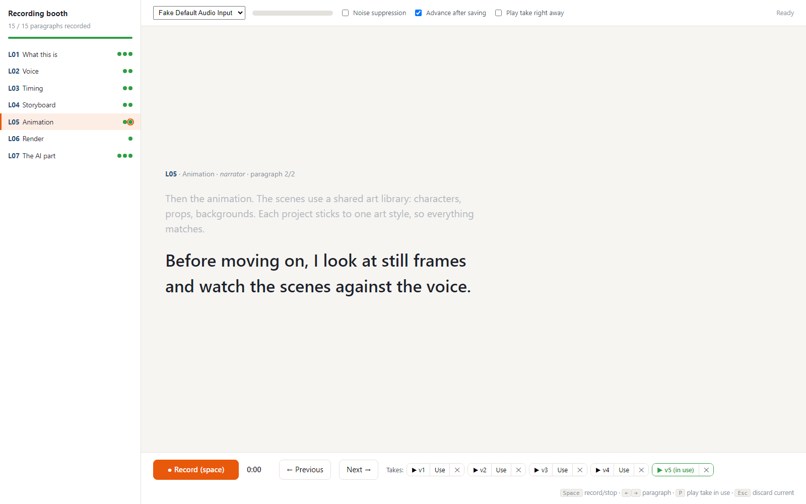
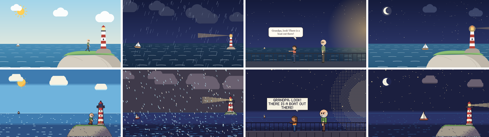
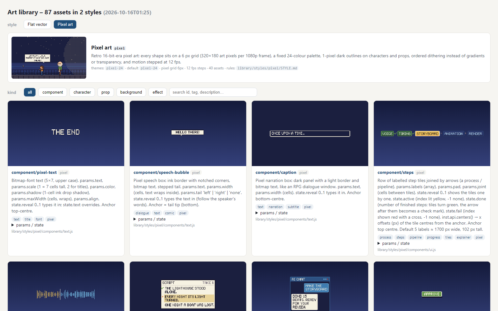
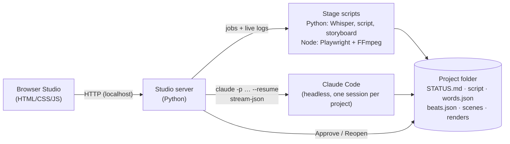

# Animation Studio

**Turns a voice recording into an animated video – with an AI that does the work and a human who approves every step.**

> This repository is a **showcase**: screenshots, a demo video and how the system works.

**▶ Demo:** [`video/welcome-video-720p.mp4`](video/welcome-video-720p.mp4) – a two-minute video about the tool,
made with the tool and narrated by me in its recording booth.

## What it does

Animation Studio borrows the workflow of a traditional animation studio and splits video making into five stages.
Each stage has a written contract (inputs, outputs, who checks it), and the next stage only unlocks when a human
approves the previous one.

| Stage | The machine | The human |
|---|---|---|
| **1 Voice** | AI drafts the brief and script; teleprompter booth records one take per paragraph | writes/approves the script, records, picks the best takes |
| **2 Timing** | Whisper times every spoken word and compares it with the script | fixes misheard names, re-records bad spots |
| **3 Storyboard** | one picture change per beat, pinned to a spoken word; a rough "Leica reel" | watches the rough cut against the voice |
| **4 Animation** | AI builds the scenes from a reusable art library; stills + automatic layout check | reviews frames, points at problems |
| **5 Render** | frame-by-frame render to MP4 (+ light version, chapters, thumbnails) | watches it, picks title and thumbnail |

## The Studio

Everything runs from one local browser app. Left: projects. Middle: the stages with previews, buttons for the stage
scripts and the **Approve / Reopen** gate. Right: Claude working on the project.

**Point instead of describe.** Click the spot in a frame and say what should change – the AI receives the beat, the
exact time and the frame with the spot marked (and a clean copy):

**Recording booth.** A teleprompter that records one paragraph per take; every take is kept, and you choose which
one the video uses.

## Art styles that can't mix

One shared engine; each **style** is a set of drawing rules plus the assets drawn with them. A project picks one
style and the engine refuses assets from any other – a pixel-art story can never show a vector tree. A style can also
switch on engine behaviour it needs: the pixel style snaps everything to a 6 px grid, steps motion at 12 fps, scales
by whole numbers, fades with dithering and only allows its 24-colour palette.

*One voice track and one storyboard, drawn in `flat-vector` (top) and `pixel` (bottom).*

*The art library: 87 assets in 2 styles – characters with a pose/motion system, props, backgrounds, effects and
diagram components – each with parameters, tags and a thumbnail at its true size in the frame.*

## How it works

- **Files are the single source of truth.** Every stage reads and writes plain files in the project folder
  (`script.md`, `words.json`, `beats.json`, scene code, `STATUS.md`), so the browser, the terminal and the AI all see
  the same state – and every step can be inspected or redone.
- **Deterministic rendering.** A scene is a pure function of time: `render(t)` draws time *t* identically every
  time. The live preview *is* the final render, and rendering splits the timeline across parallel headless Chromium
  workers piping frames into FFmpeg (a 7-minute explainer: 12,753 frames in about 13 minutes).
- **Audio first.** Whisper's word timestamps drive everything: each picture change is anchored to a spoken word, so
  re-recording a line or editing the storyboard re-times the animation automatically.
- **The AI is kept in check.** Claude Code runs headless inside the project with the same written rules as in the
  terminal, but it cannot approve its own work – it can only mark a stage *in review*. Before handing over animation,
  an automatic layout check measures every still (how much of the frame is used, how far content spreads, the
  smallest text) and flags empty or cramped frames.
- **Safe local server.** Because the server can start an AI agent, it only listens on localhost and rejects requests
  from other sites (Host/Origin checks and a required custom header against DNS rebinding and cross-site requests).

## Made with it

| Video | Length | Notes |
|---|---|---|
| Welcome video ([demo](video/welcome-video-720p.mp4)) | 1:59 | 15 beats, pixel style, narrated in the booth, made entirely in the Studio |
| "Inside Animation Studio" explainer | 7:05 | 33 beats, flat-vector style, scratch voice |
| The Lighthouse Keeper | 0:47 | a short story rendered in both styles from one storyboard |

## Tech

Python 3 (standard-library web server, faster-whisper, NumPy, Pillow) · Node.js with Playwright and a local
Chromium · FFmpeg · plain HTML/CSS/JavaScript, no build step · Claude Code (headless CLI, stream-json, per-project
sessions) · Windows speech synthesis for draft voices. About 7,000 lines of code.

## How it was built

Designed and directed by me and built together with Claude Code as an AI pair programmer – which is also how the
Studio itself works: the AI does the heavy lifting, the human sets the direction and checks every step.
